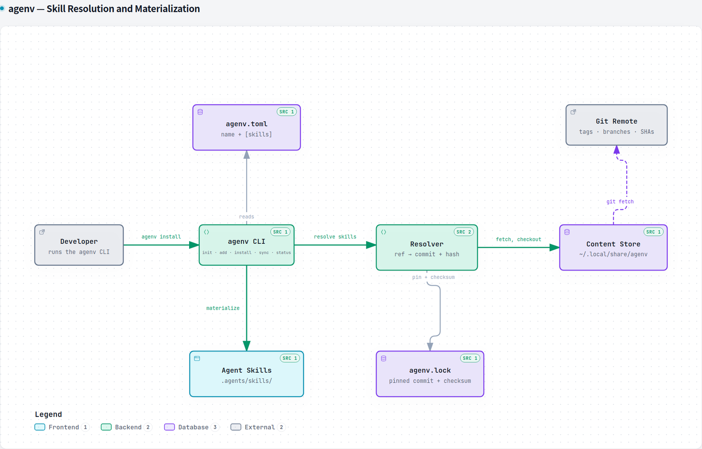

## Purpose

`agenv` is the dependency manager that coding agents were missing. You declare
which skills a project depends on in a small `agenv.toml`; `agenv` resolves each
one to an exact git commit, records a content checksum in `agenv.lock`, and
writes the result into the portable Agent Skills layout every current agent
reads — `.agents/skills/<name>/`. Commit both files and the next machine, and
the next agent, gets the same skills.

The framing in the README is the one I keep coming back to: it is *Cargo.lock
for agent skills*.

## The problem

Agent skills are shared by copy-paste. Someone links a `SKILL.md` in a chat,
someone else saves it into their harness folder, and from that moment nobody can
answer three ordinary questions: which version of that skill is this project
actually running, was it modified after it arrived, and is it the same one my
colleague has.

That is a supply-chain question, and the ecosystem has been answering it with a
README and good intentions. Meanwhile the same repositories that pin every npm
dependency to a hash are running agent instructions that were fetched once, by
hand, from a branch that has since moved.

## Architecture

There are four moving parts, and each one exists because of a specific failure
mode.

The **manifest** (`agenv.toml`) is hand-written and stays small: a project
`name` and one flat `[skills]` table with an inline entry per skill — its git
source, ref, optional subdirectory, and optional metadata.

The **resolver** turns that declaration into something immutable. It fetches
with the `git` CLI into a shared, content-addressed store — one bare clone per
source, one detached worktree per commit, both keyed by `sha256(source)` under
`~/.local/share/agenv/store/` — and hashes the resulting tree. Because the store
is content-addressed and shared across projects, the second project that needs a
commit pays nothing for it.

The **lockfile** (`agenv.lock`) is the contract. It is machine-written, sorted
by name, and holds exactly two facts per skill beyond its identity: the commit
and the checksum. When `source`, `ref` and `path` still match the lock, an
install is *frozen*: it reuses the stored commit and verifies it against the
recorded checksum without touching the network. Only `agenv update` re-resolves.

**Materialization** is the part the agents care about: copy each skill tree into
`.agents/skills/<name>/`, refusing symlinked paths and writing through a
temporary directory plus a rename, so a skill is never observed half-copied.

## Technology

**Rust**, stable, with a deliberately small dependency set: `clap` for the
command surface, `serde`/`toml` for reading the two files, `toml_edit` to write
the manifest as inline skill entries, `sha2` for checksums, `walkdir` for the
tree walks.

**Git as the transport, not a library.** Every fetch, ref resolution and tree
extraction shells out to the `git` CLI. It costs a hard dependency on `git`
being installed and buys the entire resolution semantics — tags, branches,
`origin/` prefixes, `rev-parse` — for free and without a reimplementation that
would inevitably disagree with git.

Seven commands carry the whole workflow: `init`, `add`, `install`, `sync`,
`status`, `update` and `store prune`. `add` infers the name, ref and
subdirectory from a GitHub `blob` or `tree` URL, so the common case is a paste;
`install -r <file>` turns a plain list of skill URLs into manifest entries and
installs them, which is what a bootstrap script wants.

## Challenges & decisions

**A checksum has to be stable, and a tree does not hash itself.** The obvious
implementation — tar the directory and hash the archive — embeds timestamps,
ordering and filesystem metadata, so it differs between machines for identical
content. What ships instead walks the tree with `.git` excluded, sorts the
paths, and feeds the hash each path and its bytes with explicit lengths, so
boundaries are unambiguous and the result is a pure function of the content.

**A mismatch must fail before it writes.** Verification is worthless if it
happens after the fact, so a checksum that disagrees with the lock aborts the
command with both values named and the installed tree untouched. The same
principle applies to refs: a frozen install never silently re-resolves because
the branch moved. `agenv status` is the read-only half of that contract — it
reports added, removed, ref-changed, missing and checksum-mismatch entries and
exits non-zero, which is the shape a CI check needs.

**The store is global; the lock is not.** Pruning against a global store from a
single project would delete another project's cache, so `agenv store prune` is
explicitly scoped to the current project's lock and the trade-off is documented
in the code rather than left as a surprise: a commit used elsewhere is
re-fetched on that project's next install, which is a cache miss, not data loss.

**One portable layout beats a harness list.** Early versions asked you to choose
a coding-agent harness (`init --harness`, `harness add`, a `harness = […]` field)
and scattered the output into `.claude/skills/` and `.opencode/skills/`. That is
gone: skills always land in `.agents/skills/`, the layout the ecosystem agreed
on. The per-harness directories multiplied the surface — the same lock meant
different trees depending on a setting nobody wanted to maintain — and the
portable path is what every current agent reads anyway. A manifest that still
carries a `harness` key keeps loading, because unknown keys are ignored, and
loses the key on its next write.

**Local skills are not dependencies.** A skill kept in `skills/<name>/` with a
relative source is copied straight into `.agents/skills/` and never enters the
lock — there is no commit to pin. Keeping that distinction explicit is what lets
`sync` be useful: it adopts skills found on disk (recovering the git source from
the lock when it knows one) and `sync --prune` removes whatever is in
`.agents/skills/` but not in the manifest.

**Symlinks are treated as hostile input.** A repository can commit a symlink,
and a symlink that points outside the project turns a materialize, a prune or a
local-source read into a write somewhere else. Every path that will be written
or followed is checked first — including the dangling case, where `exists()`
reports the link as absent and the next write would create its target.

## What I'd do next

Close the gap between "works on my machine" and "trusted by a team": wiring
`agenv status` into CI so a moved ref fails a pull request instead of an
install. Then the scope that is deliberately deferred — MCP servers and plugins
as first-class dependencies, and a registry that makes discovery a first-class
part of the model rather than a link in a chat. There is also one honest
limitation worth fixing first: the tool understands skills and nothing else, and
the moment a project needs an MCP server, the whole thing is back to
copy-paste.
