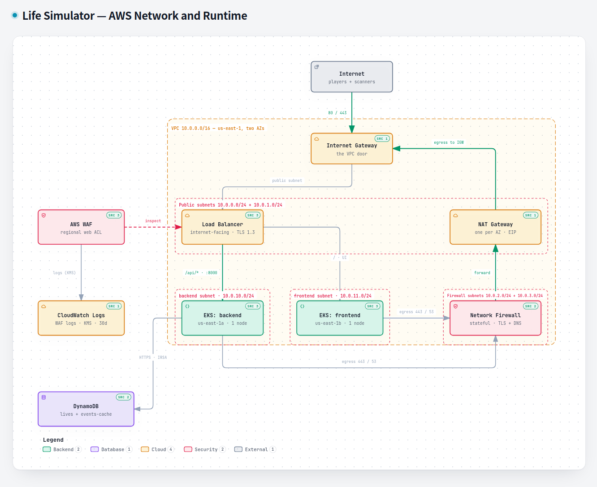
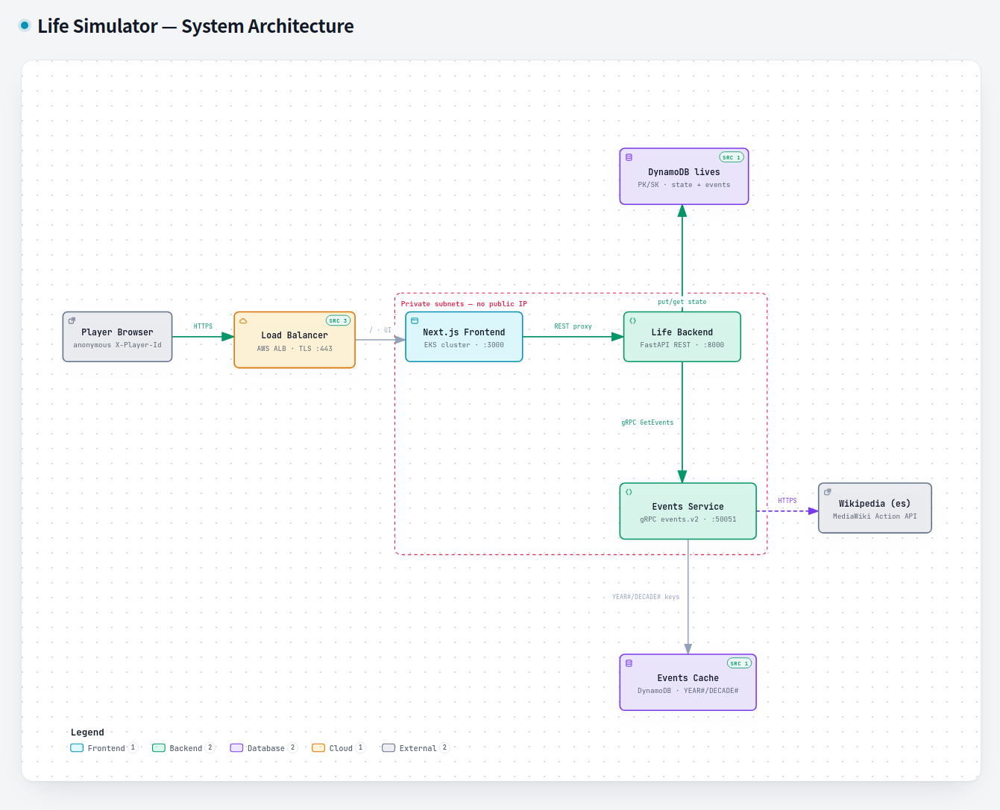
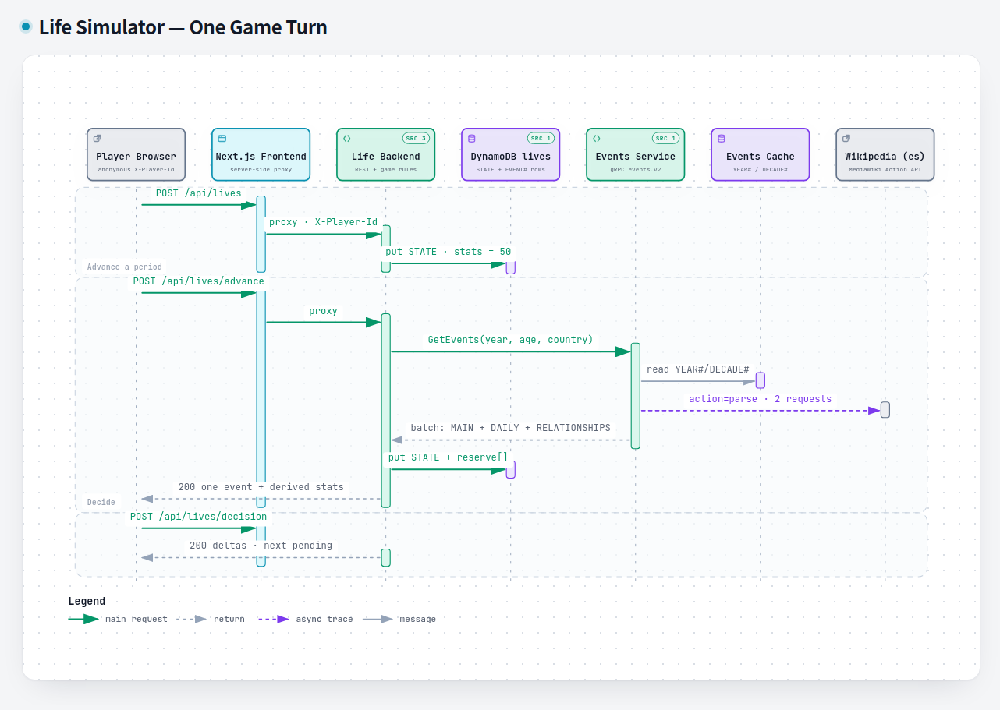

## Purpose

Life Simulator is a playable life story. You pick a gender, a country with its
city, and a birth year between 1900 and today. The game then moves one period at
a time — a year or a month, fixed at birth — and hands you a historical event
that actually happened in your country in that year. You choose between two and
four options, your four stats (*health*, *happiness*, *intelligence*, *looks*)
move on a 0–100 scale, and the people around you — parents, siblings, friends,
partners — age, drift and sometimes disappear. When the life ends, from old age
or from a fatal decision, the game groups everything you lived into three
systems — education, work and relationships — and gives you the story back.

There are no accounts. A UUID generated in the browser names the life, and that
is the entire identity model.

The project is still under active development; the roadmap below is what I am
working through next.

## The problem

I am a fan of **BitLife**, the text-driven life simulator, and I decided to take
it as the example to build my own clone. The loop is easy to imitate and hard to
make correct. A real life-sim makes demands a demo never does: every event must
belong to the player's country; the same birth data must produce the same life;
an event must never be shown twice; the upstream source is a public wiki that
rate-limits and fails; and the game must keep playing even when the network does
not.

## Architecture

Four repositories make one product, and the boundaries between them are the
point of the design.

The edge is a single internet-facing Application Load Balancer with a WAF web
ACL in front of it. It terminates TLS, answers `:80` with a 301, forwards `/` to
the frontend and sends `/api/*` to the backend. Everything behind it lives in
private subnets with no public IP, and the private subnets are one per service —
`10.0.10.0/24` for the backend in `us-east-1a`, `10.0.11.0/24` for the frontend
in `us-east-1b`, each with its own route table and NACL.

Egress is the part I am happiest with. A private subnet does not reach the
internet directly: its default route points at a Network Firewall endpoint in
its own availability zone, the firewall's stateful rules pass TLS, DNS and
established returns and drop everything else, and only then does traffic leave
through the NAT gateway. Security groups and NACLs repeat the same policy, so
there is no obvious way around the inspection.

The browser only ever talks to the Next.js origin; a server-side route handler
proxies `/api/*` to the backend, so there is no CORS surface and the backend's
address is never exposed. The backend owns the REST contract and the game rules.
It does not own the historical material: that belongs to a separate gRPC service
(`events.v2`) that runs as a ClusterIP inside the backend cluster, so the
protocol never crosses the load balancer. Storage is split the same way as the
code — two DynamoDB tables with one owner each, `${project}-lives` for the
backend and `${project}-events-cache` for the events service, each reached by
its own IRSA role whose policy names exactly one table.

A period opens with a batch — one main event, one daily event and one
relationship event — but the backend presents them one at a time and keeps the
rest queued. Advancing again while an event is pending is a conflict, not a lost
turn: the pending event is persisted, so a reload in the middle of a decision
resumes exactly where it stopped.

## Technology

**Infrastructure** — Terraform against an `aws` provider pointed at [Floci](https://github.com/floci-io/floci),
a local emulator, so the whole stack comes up offline with credentials that are
literally `test`. EKS 1.29, two clusters from one reusable module, DynamoDB
on-demand, ECR with immutable tags, WAF and Network Firewall, GitHub Actions
(`fmt -check` + `validate` + `plan` on pull requests, `apply` only on `main`).

**Backend** ([web-backend](https://github.com/Magic-Mario/web-backend)) — Python
3.12, FastAPI and Pydantic for the REST edge, boto3 for DynamoDB, grpcio for the
internal call. The domain layer has no framework imports at all: the REST
adapter and the tests drive the same `GameService`. Randomness comes from a
purpose-keyed generator rather than the system RNG, which is what makes a life
reproducible.

**Events service** ([web-events-service](https://github.com/Magic-Mario/web-events-service)) —
a gRPC server for `events.v2`, with its own DynamoDB cache table and a
`servicer` whose only job is to answer even when nothing else can. Observability
is one JSON line per resolution decision plus CloudWatch EMF metrics, so
"where did this event come from?" is answerable without guessing.

**Frontend** ([web-frontend](https://github.com/Magic-Mario/web-frontend)) —
Next.js 16 on React 19 with the App Router, TypeScript, no CSS framework, and
almost no client JavaScript: the pages render on the server and the client only
carries the decision flow.

**Infrastructure repo** ([web-infra](https://github.com/Magic-Mario/web-infra)) —
all of the Terraform above, plus the local-emulator compose file and the
multi-repo local development guide.

## Challenges & decisions

**The engine is deterministic, and that is load-bearing.** A life is generated
from its birth data through a purpose-keyed pseudo-random generator, so the same
input always yields the same draw. I evaluated wiring a generative model into
event generation and rejected it: it would have broken reproducibility, killed
stable event identifiers, and put a model at runtime in a service whose whole
value is that it is explainable.

**An event has to belong to the player's country.** The obvious source — the
Wikipedia article for a given year — is a *world* chronicle, so events from
every other country leaked in. The fix is a two-tier lookup: first the national
annex (`Anexo:<country> en <year>`), which already carries its own scope, and
only otherwise the global article filtered down to entries that name the
country. An event with no country signal at all can never be presented as the
main event of the period.

**An upstream rate limit changed the design.** The plan was to request each
section of the year page separately — about twenty requests per year. Against
the live API, Wikipedia starts answering `429` from the ninth. The shipped
version makes two requests (the table of contents, then the whole page) and
slices sections locally by character offset, which returns the same content
without duplicating anything.

**The game is never allowed to block.** If the events service times out, if the
cache is cold and the source fails, the period still resolves: the response
falls back to a seed catalogue compiled into the image, marked as such. The seed
is deliberately never cached, so a year answered from it does not permanently
shadow the real search for that year. And because the backend owns the state, it
revalidates the country and the event's conditions itself rather than trusting
what the service returned.

**Two tables, two owners, no shared database.** The events service cannot read
`-lives` and the backend cannot read `-events-cache`; each pod assumes its own
role with a policy scoped to one table. It is a stricter rule than the workload
needs today, and it is the reason the events service can be replaced without
touching a single life.

**Local-first is a constraint, not a convenience.** The same Terraform runs
against the emulator with fake credentials, which forced real decisions:
endpoints are injected rather than assumed, the emulator's gaps are documented
instead of hidden, and the deployment scripts substitute addresses that a real
cluster would discover by itself.

## What I'd do next

Turn the emulator's gaps into configuration rather than comments — the EKS
addons and IRSA injection are already declared, they simply are not exercised —
and replace the manual cross-cluster bridge with a single cluster running two
namespaces, or with a proper service mesh. Beyond the infrastructure: grow the
country catalogue past its current nineteen, add a second historical source so
the game is not a single point of dependency on one wiki, and let a finished
life be exported and shared.
